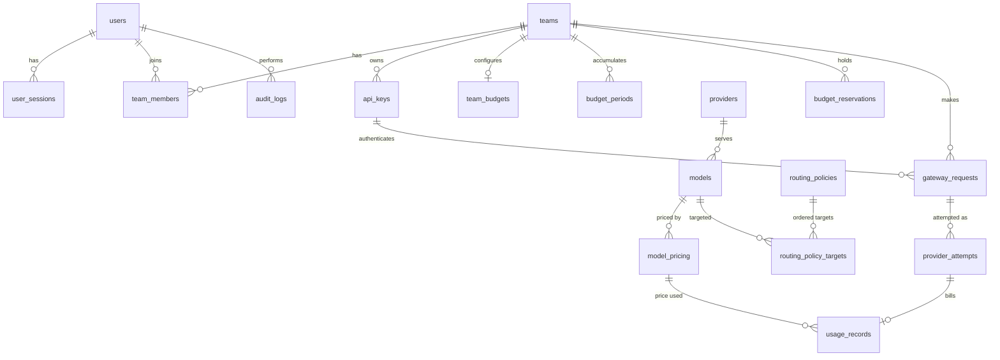

# Database Schema

PostgreSQL is the system of record for configuration, usage and spend. Redis holds only rate-limit counters and concurrency leases, which can be lost without financial impact.

The schema lives in [`service/internal/database/migrations/0001_init.sql`](../service/internal/database/migrations/0001_init.sql).

## Conventions

- Primary keys are UUID v7 (time-ordered, index-friendly), generated by the application.
- Money is `BIGINT` nano-USD (1 USD = 10⁹). Prices are nanos **per one million tokens**.
- Token columns are nullable. `NULL` means "not known"; it never means zero.
- Status columns use `CHECK` constraints instead of Postgres enums, so adding a value is a one-line migration.
- Deleting a provider or model sets `NULL` on historical requests (`ON DELETE SET NULL`); `provider_attempts` also store `provider_slug` and `model_name` so logs stay readable.

## Entity relationships



## Tables

### Identity and access

| Table | Notes |
|---|---|
| `users` | `email` unique case-insensitively (`lower(email)` index). `password_hash` is bcrypt (cost 12). `role` is `admin` or `member`. `disabled_at` blocks login and existing sessions |
| `user_sessions` | `token_hash` = SHA-256 of a 256-bit random token; the raw token exists only in the browser cookie. Expired rows are deleted hourly |
| `teams` | `rpm_limit` and `concurrency_limit` NULL mean "gateway default". `archived_at` disables all of the team's keys |
| `team_members` | PK (`team_id`, `user_id`). `role`: `owner`, `developer`, `viewer` |
| `api_keys` | `key_hash` = HMAC-SHA256(pepper, key), unique. `prefix` is the first 12 characters, for display. Raw keys are never stored |

### Provider configuration

| Table | Notes |
|---|---|
| `providers` | `type` selects the adapter. `api_key_ciphertext` = version ‖ nonce ‖ AES-256-GCM(key) with the provider ID as associated data, so a ciphertext cannot be moved to another row. `key_version` increments on rotation |
| `models` | Unique (`provider_id`, `name`). `name` is the upstream model ID sent to the provider |
| `model_pricing` | Append-only. Unique (`model_id`, `effective_from`). The version effective at request start is used and its ID stored on the usage record |
| `routing_policies` | `alias` unique; clients request it as the model name. Retry settings per policy |
| `routing_policy_targets` | PK (`policy_id`, `position`): the ordered fallback chain |

### Budgets

| Table | Notes |
|---|---|
| `team_budgets` | Optional monthly and daily limits; NULL = unlimited |
| `budget_periods` | PK (`team_id`, `period_type`, `period_start`). Calendar month and day in UTC. `spent_nanos` is updated for **every** team (so a budget added mid-month sees real spend); `reserved_nanos` only for teams with a budget |
| `budget_reservations` | One row per reserved request: `active` → `settled` or `released`. `expires_at` lets a sweeper release reservations left by a crashed instance. Partial index on active rows |

Reservation is a conditional update that takes a row lock:

```sql
UPDATE budget_periods
   SET reserved_nanos = reserved_nanos + $amount
 WHERE team_id = $1 AND period_type = 'month' AND period_start = $2
   AND spent_nanos + reserved_nanos + $amount <= $limit
RETURNING 1;   -- no row: budget exceeded
```

Settlement runs in the same transaction that writes the usage ledger: it marks the reservation settled, subtracts the reserved amount and adds the actual charge.

### Usage and logs

| Table | Notes |
|---|---|
| `gateway_requests` | One row per logical request that passed rate limiting. Denormalized totals (`input_tokens`, `output_tokens`, `cost_nanos`, `cost_status`, `budget_charge_nanos`, `attempt_count`, `fallback_count`) keep the log list join-light |
| `provider_attempts` | One row per provider call, including `skipped` rows for targets whose circuit was open. Unique (`request_id`, `attempt_number`) |
| `usage_records` | The financial ledger, 1:1 with attempts that reached a provider. `usage_status`: `reported` (provider sent final usage), `unknown` (may have consumed tokens; partial counts kept), `none` (provider rejected the request, not billable). `cost_nanos` NULL when unknown or unpriced |
| `audit_logs` | Administrative actions with actor, target and JSON metadata |

`gateway_requests.cost_status`:

| Value | Meaning |
|---|---|
| `exact` | All usage reported and priced |
| `estimated` | Some attempt had unknown usage; `cost_nanos` includes the reservation estimate for it |
| `unknown` | Usage on an unpriced model |
| `none` | No billable usage (rejected, or provider returned an error) |

## Indexes and the queries they serve

| Index | Query |
|---|---|
| `gateway_requests (created_at DESC, id DESC)` | Request log, keyset pagination for admins |
| `gateway_requests (team_id, created_at DESC, id DESC)` | Request log and analytics for one team |
| `gateway_requests (status, created_at DESC)` | Failure filters, reliability "recent failures" |
| `provider_attempts (request_id)` (via unique constraint) | Request detail |
| `provider_attempts (provider_id, started_at DESC)`, `(started_at DESC)` | Reliability stats and hourly series |
| `usage_records (created_at)`, `(team_id, created_at)` | Cost breakdowns by provider, model or team |
| `api_keys (key_hash)` unique | Data-plane authentication (cached 30 s in memory) |
| `budget_reservations (expires_at) WHERE status = 'active'` | Expiry sweeper |
| `model_pricing (model_id, effective_from)` unique | Price version lookup |

## Migrations

- Files `NNNN_name.sql` in `service/internal/database/migrations/` are embedded in the binary.
- On startup (`AUTO_MIGRATE=true`, the default) or with `api migrate`, pending files are applied in order, each in its own transaction, under a Postgres advisory lock, so concurrent instances are safe.
- Applied versions are recorded in `schema_migrations`.
- Migrations are forward-only. To change the schema, add a new file; never edit an applied one.

## Growth and retention

`gateway_requests`, `provider_attempts` and `usage_records` grow with traffic. For high volumes, partition them by month on `created_at`/`started_at` and drop or archive old partitions. Analytics queries already filter by time range, so they benefit from partition pruning without changes.
