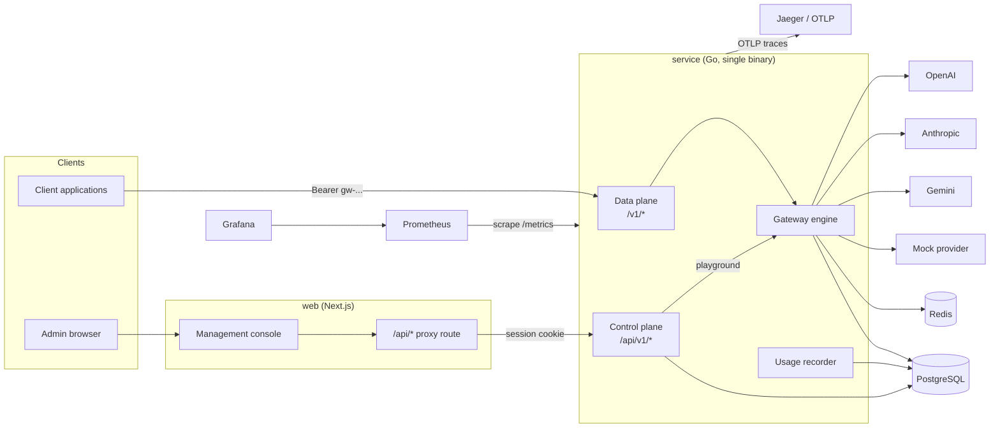
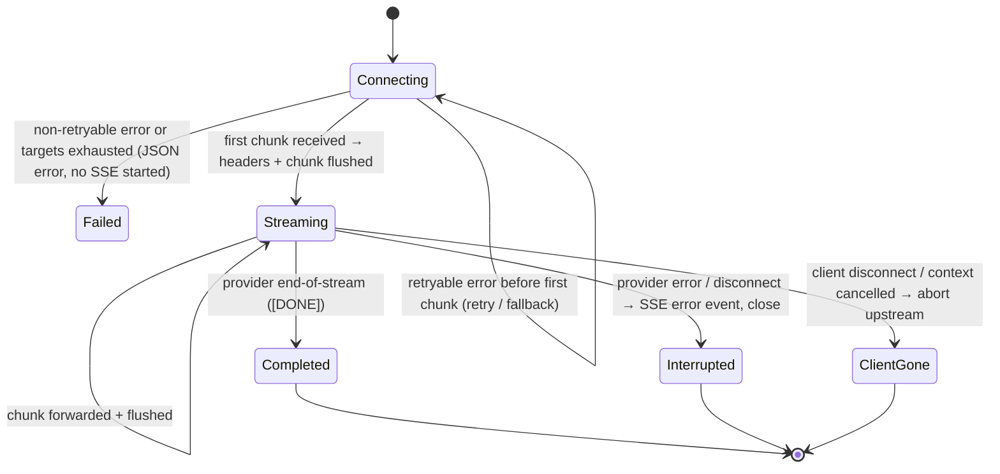
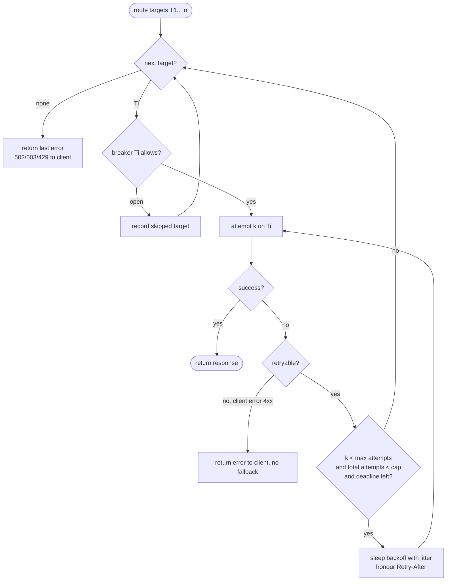
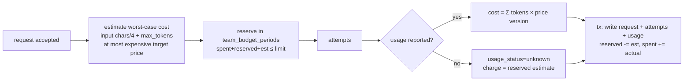

# System Architecture

## 1. High-level view



One Go binary hosts both planes. They share the database pool and the engine, but have separate route groups, authentication middleware and request-size limits. Splitting them into separate deployables later only requires a second `main` package; the packages are already independent.

## 2. Components

| Component | Responsibility |
|---|---|
| **Data plane HTTP** | `/v1/chat/completions`, `/v1/models`. API-key auth, body limits, request ID, metrics, tracing. |
| **Gateway engine** | Orchestrates a request: rate limit → budget reservation → route resolution → attempts (retry, fallback, breaker) → response/stream → settlement. |
| **Router** | Resolves the requested model into an ordered list of targets (provider + upstream model + pricing). Reads a cached snapshot of providers, models and policies. |
| **Provider adapters** | One per provider type (`openai`, `anthropic`, `gemini`). Translate the unified request, call the provider, normalize responses, stream chunks, usage and errors. |
| **Circuit breaker registry** | In-memory breaker per provider. Concurrency-safe state machine. |
| **Rate limiter** | Redis Lua scripts: sliding-window RPM and concurrency leases per team. |
| **Budget service** | Postgres reservation ledger: atomic reserve, settle, release, expiry sweep. |
| **Pricing service** | Finds the price version effective at request time; computes cost in nano-USD. |
| **Usage recorder** | Writes `gateway_requests`, `provider_attempts`, `usage_records` and settles the reservation in one transaction. |
| **Control plane HTTP** | Auth, teams, members, keys, providers, models, pricing, routing, analytics, logs, reliability, playground, audit. |
| **Config snapshot** | Providers, models, routing policies and prices are loaded into memory and refreshed on change (and every 30 s) so the hot path does not query them. |
| **Web console** | Next.js App Router. A server route `/api/[...path]` proxies to the control plane so cookies stay same-origin and SSE passes through. |
| **Mock provider** | Small Go server emulating OpenAI, Anthropic and Gemini wire formats with failure injection. Enables local demos and e2e tests without keys. |

## 3. Request lifecycle (non-streaming)

```mermaid
sequenceDiagram
  autonumber
  participant C as Client
  participant G as Gateway (data plane)
  participant R as Redis
  participant P as Postgres
  participant E as Engine
  participant A as Provider adapter

  C->>G: POST /v1/chat/completions (Bearer key)
  G->>G: request ID, body limit, JSON validation
  G->>G: key lookup (in-memory cache → Postgres on miss)
  G->>R: RPM check + acquire concurrency lease
  R-->>G: allowed / 429
  G->>E: Execute(team, request)
  E->>E: resolve route → [target1, target2, ...]
  E->>P: reserve budget (estimate of worst-case cost)
  P-->>E: reservation id / 402 budget exceeded
  loop targets in order
    E->>E: breaker allows?
    loop attempts with backoff
      E->>A: ChatCompletion(ctx)
      A-->>E: response or normalized error
    end
  end
  E-->>G: unified response + usage
  G-->>C: 200 JSON (X-Request-ID)
  G->>R: release concurrency lease
  E->>P: tx: insert request, attempts, usage; settle reservation
```

The settlement transaction runs with a context detached from the client connection, so a client disconnect cannot skip accounting.

## 4. Streaming lifecycle



Rules:
1. The gateway opens the upstream stream and waits for the **first content chunk** before writing any byte to the client. Until then, failures are treated exactly like non-streaming failures (retry, fallback).
2. Once a byte has been written the provider is fixed. Mid-stream errors produce `data: {"error": {...}}` and the stream closes. No `[DONE]` is sent in that case, so clients can tell the stream did not complete.
3. Usage at end of stream: OpenAI via `stream_options.include_usage` (the gateway always requests it), Anthropic via `message_start` + `message_delta`, Gemini via `usageMetadata` in the last chunk. The gateway emits a final OpenAI-style chunk with `usage` before `[DONE]`.
4. If the stream ends without final usage, usage status is `unknown`; the budget is charged the reserved estimate and the cost is marked `estimated`.
5. Client disconnect cancels the upstream request context; the attempt is recorded as `client_cancelled`.

## 5. Fallback lifecycle



- Non-retryable errors (400, 401, 403, 404, 422 from provider) stop immediately: switching providers will not fix a malformed request. Auth errors (401/403) do trip the breaker since they indicate a broken provider configuration, but still stop the request.
- A total attempt cap (default 6) and the request deadline bound the total work and prevent retry storms.

## 6. Usage tracking lifecycle



Failed attempts that never reached the provider (connection refused, breaker open) have no usage record. Attempts that reached the provider but failed (e.g. 500) are recorded with usage `none` when the provider reports no billing for errors. Attempts that timed out or were interrupted mid-generation are recorded with usage `unknown`.

## 7. Failure scenarios

| Scenario | Behaviour |
|---|---|
| Provider timeout | Attempt cancelled at per-attempt timeout → retryable → retry/fallback. Usage `unknown` for that attempt. |
| Provider 429 | Retryable; `Retry-After` honoured up to 5 s, otherwise fall back. Counts as breaker failure. |
| Provider 5xx / 529 | Retryable, breaker failure. |
| Provider 4xx (400/404/422) | Not retried, error mapped to OpenAI error shape and returned. |
| All targets fail | 502 `upstream_error` (or 503 when every breaker is open). |
| Redis unavailable | `RATE_LIMIT_FAIL_OPEN=false` (default) → 503; `true` → request proceeds without rate limiting, logged and counted. |
| Postgres unavailable | Budget cannot be reserved → 503. Control plane returns 503. |
| Gateway crashes mid-request | Reservation remains `active` until `expires_at`; a sweeper releases it. Spend for that request is lost (documented limitation). |
| Client disconnects (non-stream) | Upstream context cancelled; attempt recorded `client_cancelled`, usage `unknown`, charged estimate. |
| Client disconnects (stream) | Same as above; upstream connection closed promptly. |
| Provider disconnects mid-stream | SSE error event, attempt `interrupted`, usage from partial metadata if available else `unknown`. |
| Budget exhausted | 402 with OpenAI-style error `budget_exceeded`, before any provider call. |
| Unknown model | 404 `model_not_found`. |
